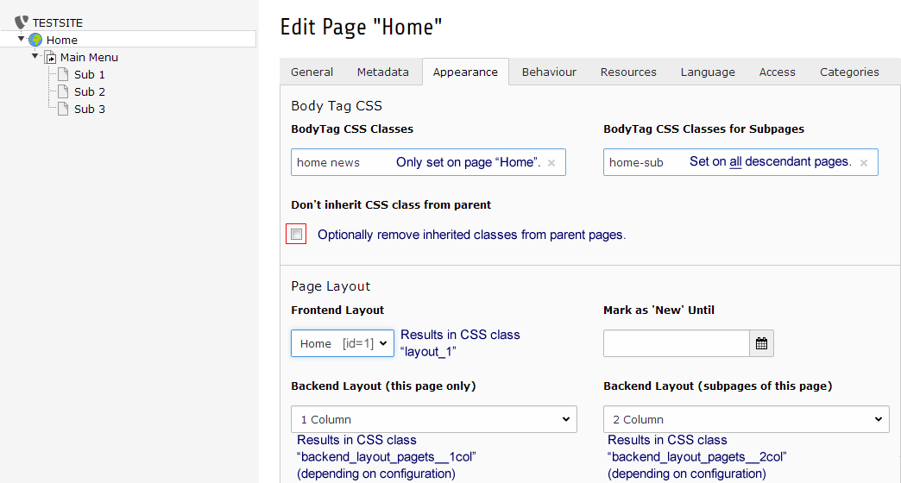
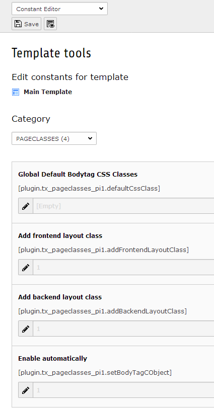
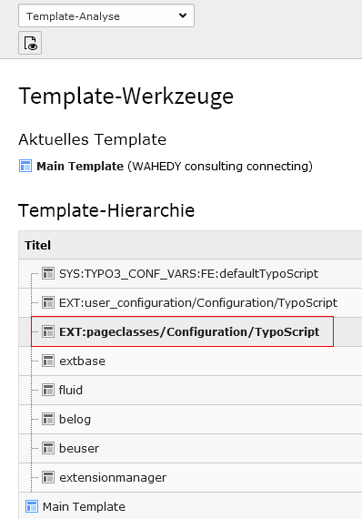
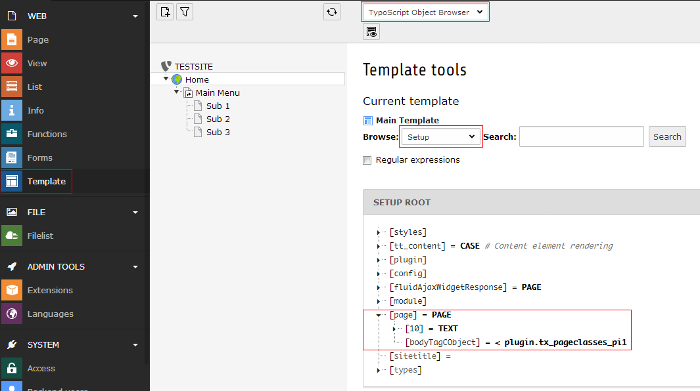

=============
Documentation
=============

----------------
What does it do?
----------------
This extension adds the possibility to add CSS classes to your pages (page properties, TAB "Appearence"), which are added to the class attribute of the body tag. This gives you full flexibility to add and remove CSS classes to special pages and branches of your pagetree. 

Additionaly CSS classes are added to your body tag, depending on the selection of your page layout (frontend & backend). 

Backend layout classes are useful, if you want to link backend layout changes to frontend layout changes easily.

Frontend layout classes are especially useful if you want authors to change frontend layout by changing frontend layout selection. Unfortunately there is no possibility to make use of inheritance. 

The extension works with TYPO3 9 LTS since version 9.0.0.

For use with older TYPO3 instances use the 8.x branch of the plugin (latest is 8.1.3, compatible with ALL versions from 8 LTS down to 4.5)

-----------
Screenshots
-----------

    Table "pages": fields to manage CSS classes in table "pages".

    Constant Editor: extension options.

-------------
Configuration
-------------

Install the extension and add the static template (from extensions) "Pagewide CSS Classes (pageclasses)" to your main TS template.

The needed TS setup is added automatically (starting with version 8.1.0). This should work for most installations out of the box.

If this is unwanted or doesn't work, you can disable automatic TS setup inclusion in the Constant Editor and add the TS Setup manually. Please see the troubleshooting section below, if the body tag is not rendered correctly.

When everything is set up correctly, the resulting body tag could look like this:
``<body class="home layout_0 backend_layout_pagets__default">``

Overview of TypoScript constants
================================

====================================  =========  ====================  ===========
Property                              Data type  Default               Description
====================================  =========  ====================  ===========
defaultCssClass                       string                           Default CSS class, added to all pages.
addFrontendLayoutClass                boolean    1                     Add CSS class depending on field "Frontend Layout" of current page.
addBackendLayoutClass                 boolean    1                     Add CSS class depending on fields "Backend Layout/Backend Layout Subpages" of current page.
setBodyTagCObject                     boolean    1                     Set page.bodyTagCObject appropriately in TS setup
====================================  =========  ====================  ===========

---------------
Troubleshooting
---------------

Before testing, enter a classname manually in the extensions constant "Global Default Bodytag CSS Classes". This makes shure, that there is a class to be added to the body tag. Reload frontend & check source code after every step.

1. Make sure that the plugin is active in the Extension Manager.

2. Make sure the extensions template is added to your main template: Open the main template ("Edit the whole template record") and in TAB "Includes" add the static template "Pagewide CSS classes (pageclasses)". You can verify inclusion with the "Template Analyser" of the TYPO3 "Template" module (screenshot "Template Analyser").

3. Sometimes the page.bodyTagCObject is set by other extensions (e. g. extension "bodyclasses") or in your own TS Setup (e. g. when configuring the formerly popular extension "automaketemplate"). You might find the source of failure with the "TypoScript Object Browser" (screenshot) and the "Template Analyser". However, to override any other setup, add the following lines to the very end of your main setup (assuming that "page" is the name of your PAGE object):

page.bodyTagCObject >
page.bodyTagCObject =< plugin.tx_pageclasses_pi1

4. Under very rare circumstances your PAGE object might have another name than "page". You can check this with the "TypoScript Object Browser" as well.

    "Template Analyser"
	

    "TypoScript Object Browser"

---------
ChangeLog
---------

See file **ChangeLog** in the extension directory.

