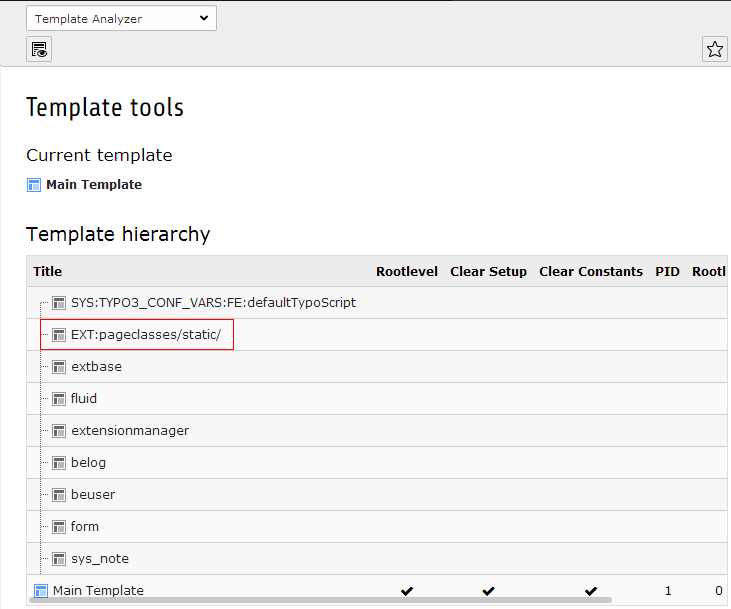

=============
Documentation
=============

----------------
What does it do?
----------------
This extension adds the possibility to add CSS classes to your pages (page properties, TAB "Appearence"), which are added to the class attribute of the body tag. This gives you full flexibility to add and remove CSS classes to special pages and branches of your pagetree. 

Additionaly CSS classes are added to your body tag, depending on the selection of your page layout (frontend & backend). 

Backend layout classes are useful, if you want to link backend layout changes to frontend layout changes easily.

Frontend layout classes are especially useful if you want authors to change frontend layout by changing frontend layout selection. Unfortunately there is no possibility to make use of inheritance. 

The extension works with TYPO3 4.5 up to TYPO3 8 LTS.

-----------
Screenshots
-----------

.. figure:: Documentation/screenshot1.png

    Table "pages": fields to manage CSS classes in table "pages".

.. figure:: Documentation/screenshot2.png

    Constant Editor: extension options.

-------------
Configuration
-------------

Install the extension and add the static template (from extensions) "Pagewide CSS Classes (pageclasses)" to your main TS template.

The needed TS setup is added automatically (starting with version 8.1.0). This should work for most installations out of the box.

If this is unwanted or doesn't work, you can disable autoamtic TS setup inclusion in the Constant Editor and add the TS Setup manually. Please see the troubleshooting section below, if the body tag is not rendered correctly.

Overview of TypoScript constants
================================

====================================  =========  ====================  ===========
Property                              Data type  Default               Description
====================================  =========  ====================  ===========
defaultCssClass                       string                           Enable ID: Body tag gets ID attribute: Value from alias field or page ID.
addFrontendLayoutClass                boolean    1                     Enable ID: Body tag gets ID attribute: Value from alias field or page ID.
addBackendLayoutClass                 boolean    1                     Enable ID: Body tag gets ID attribute: Value from alias field or page ID.
setBodyTagCObject                     boolean    1                     Enable ID: Body tag gets ID attribute: Value from alias field or page ID.
====================================  =========  ====================  ===========

---
Troubleshooting
---

1. First make sure that the plugin is active in the Extension Manager.

2. Make sure the extensions template is added to your main template: Open the main template ("Edit the whole template record") and in TAB "Includes" add the static template "Pagewide CSS classes (pageclasses)". You can verify it with the "Template Analyser" of the TYPO3 "Template" module (screenshot "Template Analyser").

3. Sometimes the page.bodyTagCObject is set by other extensions (e. g. extension "bodyclasses") or in your own TS Setup (when configuring the formerly wide used extension "automaketemplate"). So check with the "TypoScript Object Browser", if TS Setup is set correctly (screenshot). If it is not, check your setup (the "Template Analyser" might help again). If you are not able to find or remove the erroneous setup, add the following lines to the very end your main setup (assuming that "page" is the name of your PAGE object):

page.bodyTagCObject >
page.bodyTagCObject =< plugin.tx_pageclasses_pi1

4. Under very rare circumstances your PAGE object might have another name than "page". You can check this with the "TypoScript Object Browser" as well.

    "Template Analyser"
	
.. figure:: Documentation/object-browser.png

    "TypoScript Object Browser"

---------
ChangeLog
---------

See file **ChangeLog** in the extension directory.

